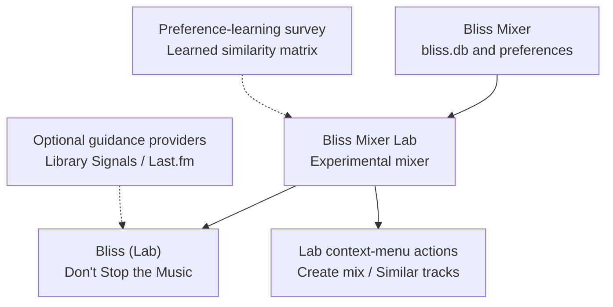

# Bliss Mixer Lab

**Explore more personal and experimental Bliss mixes.**

Bliss Mixer Lab is a companion plugin for [Lyrion Music Server (LMS)](https://lyrion.org/) and [Bliss Mixer](https://github.com/CDrummond/lms-blissmixer). It provides a place to try early-access mixing features **without replacing or changing** your existing Bliss Mixer installation.

Some experiments may change, disappear, or eventually be proposed for inclusion in [Bliss Mixer](https://github.com/CDrummond/lms-blissmixer).

## What can I do with it?

### Make Bliss mixes more personal

Take a music-preference survey and let the plugin learn a similarity matrix from your choices. When enabled, the learned preferences can influence Adaptive Bliss mixing. You can control their influence and back up or restore the training data.

### Try a different Don't Stop the Music experience

**Don't Stop the Music (DSTM)** automatically chooses more tracks to keep music playing. Bliss Mixer Lab adds a separate **Bliss (Lab)** provider, so you can experiment with enhanced mixing while keeping the Bliss provider available.

The Lab provider follows the mixing strategy and filters configured in [Bliss Mixer](https://github.com/CDrummond/lms-blissmixer) and can add learned preferences and optional guidance from listening history or Last.fm.

### Guide your DSTM mixes with listening history or Last.fm

Install the optional [Library Signals](https://github.com/chrober/lms-guidance-library-signals) and/or [Last.fm Guidance](https://github.com/chrober/lms-guidance-lastfm) plugins and enable them in Bliss Mixer Lab to influence track choices in **Bliss (Lab)** Don't Stop the Music mixes.

For example, Library Signals can help you rediscover songs you haven't played in a long time, favor newly added music, or give rarely played tracks more attention. Last.fm Guidance brings in similar-track and similar-artist information as another way to identify promising music.

These providers **do not create mixes by themselves**. They contribute additional guidance to the Lab's existing Bliss-qualified candidate selection; acoustic similarity and repeat rules still apply.

### Control artist repeats more precisely

Choose how artists with shared or complex credits are treated for repeat avoidance. The Lab supports MusicBrainz-identifier-aware artist identities and policies based on shared artists, primary artists, or exact credits. This is useful when collaborations and differing artist credits affect which tracks can play close together.

### Try alternative Bliss menu actions

Use **Create bliss mix (Lab)** for tracks, albums, or artists, along with **Similar tracks (Lab)** and **Similar tracks by artist (Lab)**. These use the separate Lab mixer and its configured strategy, including Adaptive weighting and a learned matrix when enabled.

## Key features

- Preference-learning survey and native learner producing a learned similarity matrix, with configurable influence and training-data backup/restore.
- Separate **Bliss (Lab)** DSTM provider that follows the strategy, filters, and candidate-selection refinements configured in [Bliss Mixer](https://github.com/CDrummond/lms-blissmixer).
- MusicBrainz-ID-aware artist repeat policies: shared artist, primary artist, or exact credit.
- Optional integration with compatible **Bliss Guidance** providers such as [Library Signals](https://github.com/chrober/lms-guidance-library-signals) and [Last.fm](https://github.com/chrober/lms-guidance-lastfm). Hosts discover these separately installed providers but keep them disabled until you enable them.
- Separate Lab context-menu actions, alongside those provided by [Bliss Mixer](https://github.com/CDrummond/lms-blissmixer).

Guidance providers influence the ranking of an already Bliss-derived candidate pool. They do not replace Bliss similarity or independently select tracks.

## How it fits into the Bliss ecosystem

| Component | Purpose | Required? |
| --- | --- | --- |
| [Bliss Mixer](https://github.com/CDrummond/lms-blissmixer) | Analyzes your library, maintains `bliss.db`, and supplies the base mixing preferences | **Yes** |
| **Bliss Mixer Lab** | Runs the experimental mixer, DSTM provider, survey, and learner | This plugin |
| [Better Call Bliss](https://github.com/chrober/lms-better-call-bliss) | Separately optimizes playlists and player queues; can use a learned matrix supplied by an enabled Lab installation | No |
| [Library Signals](https://github.com/chrober/lms-guidance-library-signals) | Optional guidance from play counts, last-played dates, and library age for **Bliss (Lab)** DSTM mixes | No |
| [Last.fm Guidance](https://github.com/chrober/lms-guidance-lastfm) | Optional similar-track and similar-artist guidance for **Bliss (Lab)** DSTM mixes | No |

Bliss Mixer Lab installs alongside [Bliss Mixer](https://github.com/CDrummond/lms-blissmixer). It does not modify that plugin or its library analysis, or replace its DSTM provider.

## Architecture



Bliss Mixer Lab builds on Bliss Mixer's existing library analysis and settings without modifying that plugin. Its experimental mixer can use a learned similarity matrix, while the separate **Bliss (Lab)** DSTM provider can also incorporate optional guidance from Library Signals and Last.fm.

## Requirements

- **Lyrion Music Server:** Developed and tested with **Lyrion 9.1**. Older versions may also work, but have not been tested.
- A compatible [Bliss Mixer](https://github.com/CDrummond/lms-blissmixer) installation, enabled and configured. Bliss Mixer Lab uses its existing library analysis and mixing preferences without replacing the plugin.
- A completed Bliss library analysis, with a readable `bliss.db` in the LMS preferences directory.
- A configured local music folder whose tracks match that analysis.
- Compatible native `bliss-mixer-lab` and `bliss-learner` binaries. Official plugin-feed packages provide binaries for Windows, macOS, x86_64 Linux, ARM64 Linux, and ARMHF Linux.
- **Optional:** [Library Signals](https://github.com/chrober/lms-guidance-library-signals) and/or [Last.fm Guidance](https://github.com/chrober/lms-guidance-lastfm), installed separately and enabled in Bliss Mixer Lab. [Better Call Bliss](https://github.com/chrober/lms-better-call-bliss) is not required.

Bliss Mixer Lab can create mixes without a learned similarity matrix or either guidance provider. It uses Bliss Mixer's acoustic analysis and mixing preferences; the learned matrix and additional guidance enhance the results only when available and enabled.

## Installation

1. Install and enable [Bliss Mixer](https://github.com/CDrummond/lms-blissmixer), then complete its library analysis.
2. In **LMS Settings > Plugins**, add this additional repository if you have not already done so:

   ```text
   https://raw.githubusercontent.com/chrober/lms-plugins/main/repo.xml
   ```

3. Install **Bliss Mixer Lab** through the plugin manager and restart LMS when requested.
4. Enable both [Bliss Mixer](https://github.com/CDrummond/lms-blissmixer) and Bliss Mixer Lab.

The feed selects the matching package, including the native `bliss-mixer-lab` and `bliss-learner` programs.

## Getting started

1. Open the **Bliss Mixer Lab** settings page and review its experimental options.
2. To try its automatic mixing, select **Bliss (Lab)** as the **Don't Stop the Music** provider.
3. To personalize mixes, complete the preference-learning survey and enable the learned weighting where applicable.
4. Optionally install and enable compatible guidance providers to let listening history or Last.fm information contribute to selections.
5. Try **Create bliss mix (Lab)** or the Lab's similar-track actions from the appropriate track, album, or artist menu.

If you prefer standard mixing, you can continue using [Bliss Mixer](https://github.com/CDrummond/lms-blissmixer) and its DSTM provider.

## Configuration and limitations

- **Experimental by design:** Features and settings may be added, changed, removed, or migrated upstream.
- **Learned preferences are optional:** They apply where the selected mixing strategy supports them; they do not replace all acoustic similarity rules.
- **Guidance is opt-in:** Installing a provider alone does not change your mixes.
- **Separate operation:** [Bliss Mixer](https://github.com/CDrummond/lms-blissmixer) remains installed and functional alongside the Lab plugin.

## Technical details

### Responsibilities and isolation

- [Bliss Mixer](https://github.com/CDrummond/lms-blissmixer) analyzes the music library and owns `bliss.db`.
- Bliss Mixer Lab reads that database and the upstream mix preferences, and owns the separate processes, preferences, and data required by its experiments.
- The Lab does not register a replacement analyzer, importer, Bliss Mixer URL protocol, or default context-menu handlers. Its Lab actions have distinct names.
- Its mixer uses a separate, automatically selected loopback port, observes upstream analysis, and reloads when `bliss.db` changes.
- Compatible guidance providers are passive, separate plugins; the Lab invokes enabled providers through the shared host contract for its Bliss-derived DSTM candidates.

For internals and the staging/migration model, see [ARCHITECTURE.md](ARCHITECTURE.md) and [GUIDANCE_PROVIDER_HOST_INTEGRATION.md](GUIDANCE_PROVIDER_HOST_INTEGRATION.md).

### Development and testing

For development, place or symlink `BlissMixerLab` into the LMS plugin directory and download native binaries with:

```text
python download-binaries.py
```

Pushes and pull requests run repository checks, feed-update unit tests, and the Perl regression suite. Tests cover upstream compatibility, DSTM identity and port isolation, inherited mixer preferences, survey persistence, training-data backup/restore, learned-matrix replacement, and guidance-provider integration and failure handling.

A separate scheduled **BlissMixer DSTM drift** workflow compares adapted or cloned upstream logic with the reviewed upstream revision. Meaningful changes require review rather than automatically accepting a new baseline. For the full Debian-based plugin test suite, install dependencies from `.github/workflows/validate.yml` and run `prove -l tests`.

### Releases

Version tags trigger `.github/workflows/release.yml`. The workflow validates the plugin, downloads pinned native releases and verifies SHA-256 files, produces separate Linux, macOS, and Windows packages, publishes a GitHub Release, and updates the relevant entries in [chrober/lms-plugins](https://github.com/chrober/lms-plugins). The relevant pins are in `BlissMixerLab/Bin/SOURCE.md`.

Feed publication uses `LMS_PLUGINS_TOKEN` (the legacy `MS_PLUGINS_TOKEN` name is also accepted) with the required repository permissions. A manual `dry_run=true` builds packages for inspection without publishing them.

## License and credits

The plugin includes code adapted from Craig Drummond's GPLv3-licensed [Bliss Mixer](https://github.com/CDrummond/lms-blissmixer). Metric learning is based on `bliss-metric-learning` by Polochon-street.

Distributed under the GNU General Public License v3. See [LICENSE](LICENSE).
