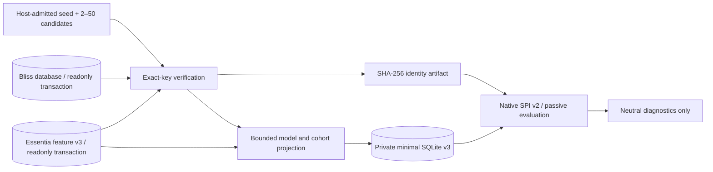

# P1.5: Bounded Essentia shadow data access and P2 provenance gates

Status: **native-tested, standalone research code on Draft PR #3**. No Lab DSTM, player,
Settings.pm, guidance weighting, Better Call Bliss or production playlist calls were changed.

## What has been implemented

- `BlissMixerLab/EssentiaBoundedSnapshot.pm` opens the Bliss SQLite source and
  the Essentia SQLite-v3 source independently with `SQLITE_OPEN_READONLY`,
  `PRAGMA query_only=ON` and pinned read transactions. No SQLite full-file
  backup or source migration is attempted.
- `EssentiaExactIdentity.pm` still verifies each exact binary `TracksV2.File`
  hit and at least one matching `feature_tracks.track_file` hit. Only an
  entire host-supplied cohort of one anchor plus 2–50 admitted candidates
  can generate its SHA-256-bound identity artifact.
- `project_features()` selects **one requested model and only these 3–51
  verified track_file identities**. It verifies the requested exact model
  key, required class count (genre=87 / moodtheme=56), required capability,
  SQLite BLOB storage class and Float32LE vector length before writing.
  A wrong or missing head aborts the **whole cohort**.
- The temporary private SQLite-v3 sidecar contains a `feature_models` row
  and at most 51 `feature_tracks` rows; it is limited to 4 MiB and sealed
  mode 0400. The original native `essentia-feature-sqlite-v3` resource
  contract and the pinned native provider remain unchanged.
- The `EssentiaShadowProbe.pm` now uses this projection as its only native
  feature resource. Its four-step `describe`/`prepare`/`score`/`close`
  transcript, opt-in, native deadline, neutral-only signals and fail-closed
  behavior are unchanged. No experimental score enters the mixer.

### Data flow

### Scaling

- Full-copy disk usage and source size limits are **removed from run_shadow**.
  The prior implementation could copy up to two entire 256 MiB databases.
  The new implementation reads source database indexes and projects only
  the selected model/track vectors. Feature export is bounded by the
  admitted cohort, independently of total library size.
- SQLite readers retain short-lived transactions through identity check
  and projection. Do not hold the transactions while the native subprocess
  runs. Distinct databases do not share an atomic transaction.
- Only synthetic CI measurements currently exist. No wall-time, source
  I/O or RAM budgets have yet been benchmarked on an actual Pi or Lyrion
  library. SQLite page-cache and WAL files can still incur I/O.

## Generation identity: REQUIRED for a real host-controlled run

**Not implemented.** Two individually pinned read snapshots are NOT a
joint library generation; a changed Bliss scan and a stale Essentia
feature sidecar may appear mutually exact on the same relative file key.
Comparing database file names, file modification times, or SQLite
`PRAGMA data_version` values is not a cross-database generation proof.

Proposed host-owned `lyrion-library-generation-v1` contract:

1. The host provides an opaque scan generation token associated with
   the actual Bliss `TracksV2` catalogue and a canonical ordered set of
   configured music roots. A rescan or root change invalidates this token.
   The plugin must never write that token into Bliss's own database.
2. The Essentia analyser records the same host-supplied generation token
   in **its own** provenance metadata with the model fingerprint, root
   namespace and analysis cohort. The scanner cannot invent an LMS token
   from feature DB timestamps. Existing v3 data without such evidence is
   non-eligible for a live shadow run.
3. At request admission, the host captures token + complete eligible
   candidate list. The reader checks the recorded source generation
   and each model head's freshness/provenance under its pinned read
   transaction. Before reporting, the host must recheck that the LMS
   generation and admitted candidate set are still current. Any
   mismatch or unavailable witness yields neutral fallback.
4. `feature_track_state` (file_size/modified_ns/model_key) and
   `audio_sha256` are useful supporting per-track freshness evidence,
   **not substitutes** for root provenance or source generation equality.

Which Lyrion scan event/API can issue a trustworthy generation token and
how the offline Essentia scanner receives it still require implementation.
Until this is resolved, the shadow runner remains manually isolated.

## Multiple music folders: root-qualified identity, not fuzzy matching

**Not implemented.** The present verifier deliberately accepts only
one distinct configured music root, because `TracksV2.File` and
`feature_tracks.track_file` are relative and carry no root identifier.
Different physical roots may contain the same relative filename.

Required contract:

- The host records exact per-track `(canonical_root_id, absolute_path,
  relative_TracksV2_File)` from trusted LMS track objects and its own
  configured root list, requiring a separator-aware path boundary.
- The analyser records the source root **actually used to decode** each
  audio file, including its matching generation and immutable root-map
  fingerprint. This witness must be compared with the host's witness.
- If two physical roots could resolve one exact `TracksV2.File` identity,
  or paths overlap without a unique owning root, reject the whole batch.
  The current SQLite-v3 `(track_file,model_id)` key cannot represent two
  independent recordings that share a relative key.
- Never infer origin from `urlmd5`, artist/title, case-insensitive joins,
  root-prefix guesses or a match in two separate databases.

Root provenance may live in a trusted host/scanner sidecar; the native SPI
model/score payload need not change. Changing the feature-store schema
requires an explicit migration and compatibility review, not a silent
change to SQLite v3.

## Verification on 31 October 2026

- `tests/essentia_bounded_snapshot.t`: large synthetic source versus a
  three-row projected DB, preserved SQLite BLOB and v3 metadata, concurrent
  WAL writer versus pinned snapshot, missing key, wrong model and duplicate
  cohort fail-closed, and nonexistent DB does not get created.
- `tests/essentia_shadow_probe.t`: real native v2 transcript runs against
  the projected private feature DB, without copying source databases.
- Pinned provider revision:
  `de72433d9c690e1aa46e973bbcca63691e959df8`.
- Initial green CI: [native integration, 69 assertions]
  (https://github.com/chrober/lms-blissmixer-lab/actions/runs/41189833771)
  and [general CI, 329 assertions]
  (https://github.com/chrober/lms-blissmixer-lab/actions/runs/41189833767).
  Later hardening additionally tests equal-sized invalid TEXT masquerading
  as a Float32LE BLOB; final commit CI is authoritative.

## Next gated milestone: passive comparison in a running Lyrion host

1. Implement source-generation and per-root provenance attestation,
   backed by host/scanner-owned evidence and negative tests for rescans,
   nested roots and cross-root collisions.
2. Freeze one real **Bliss-admitted** seed + candidate pool, run unchanged
   Bliss results as control, and run this manual-only Essentia shadow
   evaluator with the **same candidates**. Keep all Essentia signals
   non-active and capture only aggregate coverage/fallback/latency.
3. Do not integrate with `DSTM` selection, queue, routes, playlists or
   `Settings.pm` before provenance, model validity, low-power performance
   and required legal/distribution gates have been reviewed.

**No production go decision is made by this document.**
